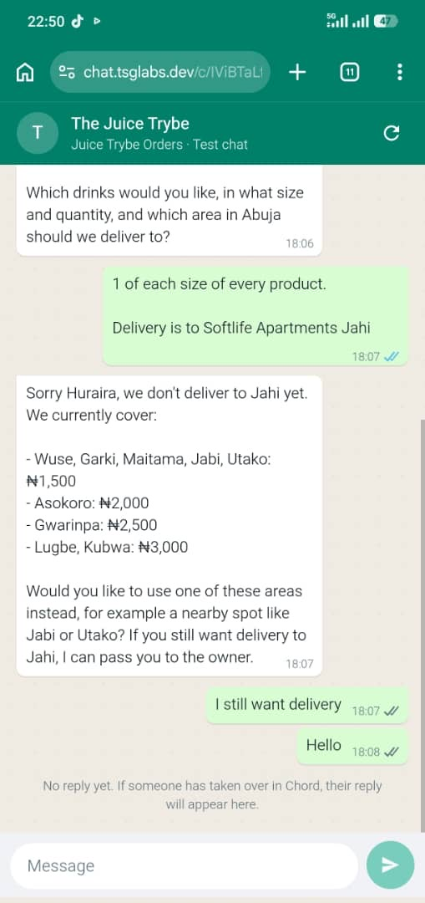
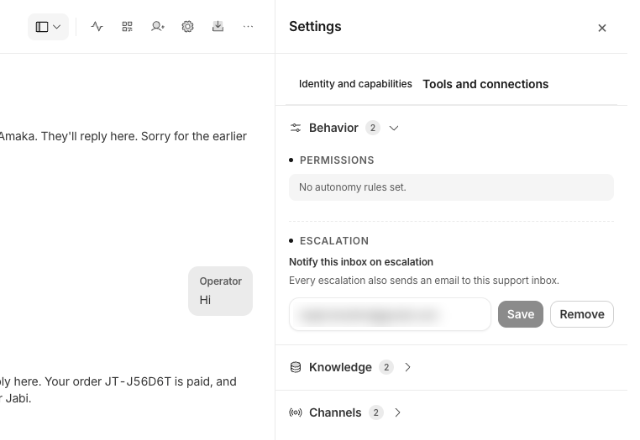

# Field notes

Problems we hit with Chord itself while building and testing this agent, most important first. Times are UTC.

## 1. The teammate forgets its own tool results between messages

This was the biggest problem. Chord doesn't seem to show the model the results of tools it called in earlier messages. On the next message, the teammate saw an order reference in its own earlier reply, found no tool call behind it, and decided it had made the reference up. It apologised, created duplicate orders, and once asked a customer who had already paid to pay again.

### What happened

- **Laptop, simulator (2026-10-27 11:18).** The teammate created order JT-8R9KYW and sent the payment link. After "i have paid", it said "The reference and link I gave you earlier weren't real" and offered a link for a new order, JT-7BPHRD. The customer had already paid JT-8R9KYW. Seventeen minutes later it reversed itself: "You don't need to pay again."
- **Phone, simulator (11:31).** It apologised for a message it never sent ("Order JT-KEJDQX was valid all along, and I was wrong to say otherwise"), but kept the right reference, and the payment confirmed straight away.
- **In-app chat and an earlier simulator chat (2026-10-26).** After "yes please", it called its reference wrong and created a second order. Both orders are in our database, seconds apart.

### How we found the cause

- **Our database** had both orders every time. The reference the teammate called "not real" was always real.
- **Chord's thread records** (`GET /v1/threads/{id}/turns`, `metadata.tools_used`) showed the reply after "Yes please" calling `create_order` a second time, even though it had already run.
- **The cause is inferred.** Chord doesn't show the model's context, and `tools_used` only records each tool's name and `ok`. The apologies for messages never sent suggest the model also sees draft text the customer never received.

### Fix

Adding "An order reference you gave earlier in this chat is real." to the skill made it rarer but didn't stop it. So we changed the tools so no step depends on the model remembering a tool result:

- **`quote_order` prices the order and saves nothing**, so repeating it does no harm.
- **`create_order` saves the order and creates the Paystack link in one call**, so the customer first sees the reference next to the link.
- **Repeat calls are safe.** Calling `create_order` again for the same order returns the same reference and link, or says it's already paid.

Three fresh simulator chats afterwards each produced one order and no apologies.

### What we'd change in Chord

- **Keep tool results in later messages, or document that they're dropped.** One line in "Build a teammate", such as "Tool results aren't carried into later messages, so make write tools safe to repeat", would have led us to this design on day one.
- **Show tool arguments and results** in the thread turns API and the "How I did this" trace. `tools_used` only gives each tool's name and `ok`, which made this slow to diagnose.

## 2. Handoffs reach neither the customer nor the owner

When the teammate hands a chat to a human, the customer sees nothing and the owner isn't told. The owner of The Juice Trybe hit this when she tried it as a customer. Her words: "it ignored her".

### What happened

- **The business owner's test, as a customer (2026-10-27 17:08).** She asked for delivery to an area we didn't cover yet, then wrote "I still want delivery". The teammate handed off with a correct reason: "Customer Huraira wants drinks delivered to Softlife Apartments, Jahi, which is outside the listed delivery areas…". She got no reply, so she wrote "Hello" 17 seconds later. No escalation email arrived at the inbox set so nobody knew she was waiting.
- **Two more handoffs went the same way:** a 40-bottle office party order (2026-10-26 18:58), and our own repeat test asking for the owner (2026-10-27 19:58). Each handed off within seconds with a correct reason, and the simulator only ever showed "No reply yet". The repeat test sent no email either. The first came before we had set an inbox.

### How we found it

- **Chord's thread records.** After each handoff, the only message Chord sent was a system acknowledgement, "One moment — connecting you with a teammate.", marked `delivery_status: "sent"` (`GET /v1/threads/{id}/turns`). The simulator never showed it.
- **The teammate's own message is missing.** The skill tells it to say it's passing the customer to the owner, then call `handover_to_human`. None of the three handoffs has that message. We can't tell whether Chord dropped it or the model never wrote it.
- **The email setting was right.** The API returned our inbox, and Chord marked both later chats as escalated (`control_state: "human_active"`). No email arrived for either, in the inbox or in spam, and nothing shows whether Chord tried to send one.

### Fix

None on our side. Inside Chord the handoff works: the AI pauses and the owner can reply from Chord. But they only find out by opening Chord, and the customer is left with no reply.

### What we'd change in Chord

- **Show handoffs to the customer.** Deliver the acknowledgement to external chats like the simulator, and keep the teammate's own message when it hands off.
- **Send the escalation email, and show that it did.** Put a delivery log (sent, bounced, last sent) and a "send test email" button next to the setting. Warn when a teammate can hand off but has no inbox set (section 4).
- **Let builders test handoffs in the in-app chat.** `handover_to_human` is only offered "on thread-bound turns", so we couldn't test any of this before connecting the simulator.

## 3. "New conversation" in the in-app chat kept the old history

- **What happened.** A new conversation in Chord's in-app chat greeted us with "your Jabi order" and "your Lekki office request" from earlier tests.
- **How we found it.** `GET /v1/threads` shows one `direct_line` thread per operator, holding every in-app message. The teammate's learned memory was empty, so memory wasn't the cause.
- **Fix.** We tested with the WhatsApp Simulator instead, which gives each browser its own thread.
- **What we'd change in Chord.** Make "New conversation" start a fresh thread, or label it as a continuation.

## 4. The escalation email setting is hard to find

- **What happened.** The gear icon on the teammate's page opens a Settings window with no escalation field. The field is in a second Settings, behind the sidebar icon next to the gear: choose **Settings**, then **Tools and connections**, then expand the collapsed **Behavior** section.
- **How we found it.** We set the inbox through the API first (`PUT /v1/teammates/{id}/escalation-notifications`), then searched the app for it. A gear reads as "settings", so it's where everyone looks first, and nobody expects a settings menu inside a button that toggles a side panel.
- **Fix.** None needed once found. The README's setup steps link here so the next person doesn't have to search.
- **What we'd change in Chord.** Keep one Settings: make the gear open the panel with the escalation field, or move the field into the gear's window.

